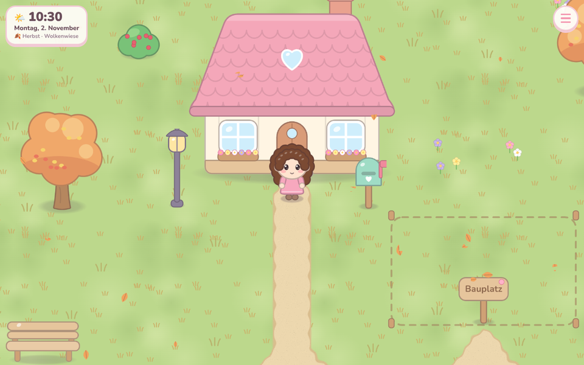
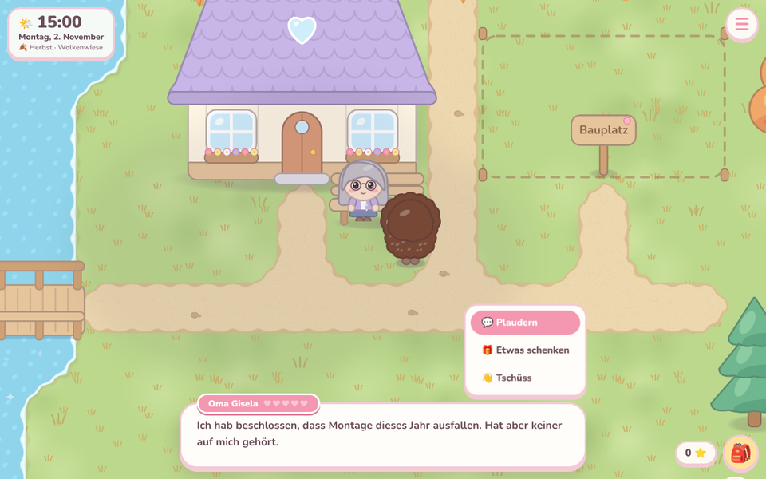
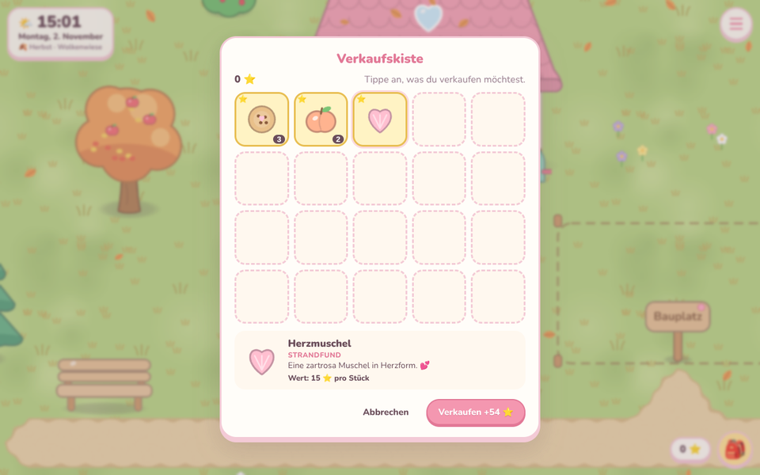
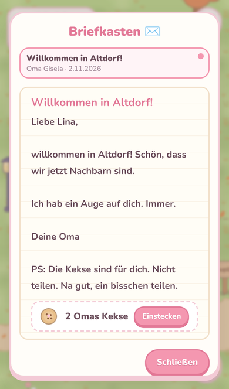
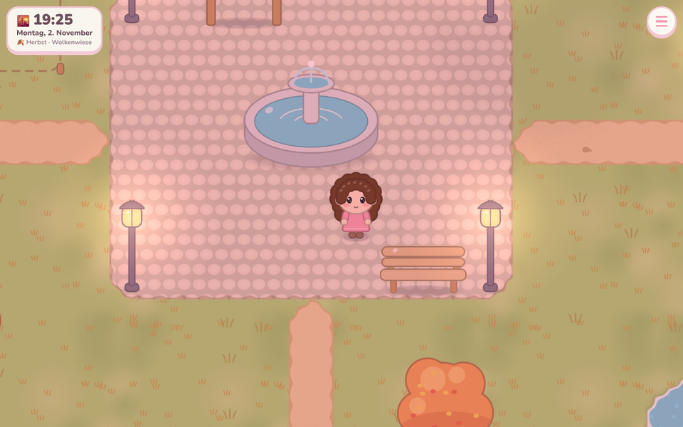
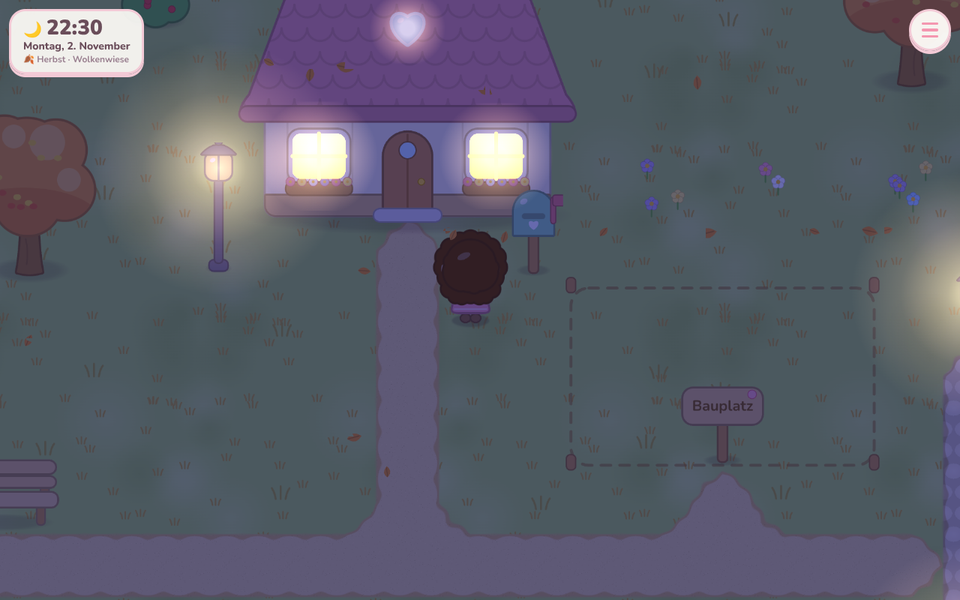
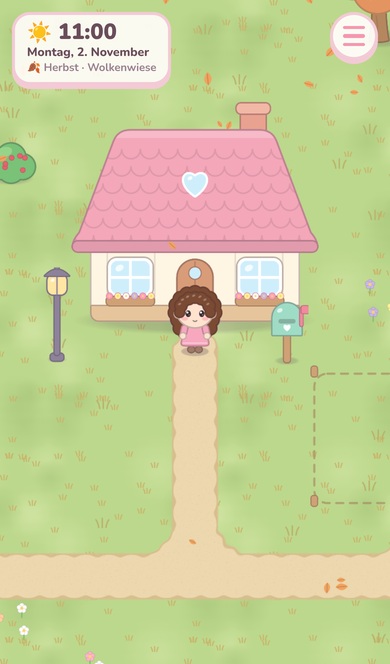

# Rina no Chiisana Sekai 🌸

**りなの ちいさな せかい – Linas kleine Welt**

Ein gemütliches Life-Sim-Spiel im Browser, gemacht mit Liebe für Lina. 💕
Lina zieht in ein kleines, verschlafenes Dorf und macht es nach und nach zu ihrem Zuhause – und mit der
Zeit ziehen ihre Liebsten dazu.



## Spielen

👉 **<https://oliverm93.github.io/Rina-no-chiisana-sekai/>**

Läuft in jedem modernen Browser auf Laptop, PC, Tablet und Handy. Der Spielstand wird automatisch im
Browser gespeichert.

| | Tastatur | Maus / Touch |
|---|---|---|
| Laufen | WASD oder Pfeiltasten | irgendwohin klicken/tippen |
| Rennen | Umschalttaste halten | (lange Wege rennt Lina von allein) |
| Anschauen / Reden / Aufheben | Leertaste, E oder Enter | auf Dinge tippen |
| Tasche | I oder Tab | 🎒 unten rechts |
| Menü | Esc | ☰ oben rechts |

**Was es zu tun gibt:** Oma Gisela besuchen (sie sitzt gern auf ihrer Bank), plaudern und ihr etwas
schenken, Bäume schütteln, Muscheln sammeln, Blumen pflücken, an Felsen klopfen, Gesammeltes in der
Verkaufskiste gegen Sternchen ⭐ tauschen und Briefe im Briefkasten lesen.

Im Menü: Aussehen ändern, speichern, **Spielstand exportieren/laden** (als Datei – praktisch zum Sichern
oder für ein anderes Gerät), Vollbild, Hilfe.

Die Uhrzeit im Dorf ist die **echte Uhrzeit**: Abends gehen die Laternen an, nachts leuchten die Fenster,
und jede Jahreszeit sieht anders aus.

| Oma Gisela | Tasche & Verkaufskiste | Post (Handy) |
|---|---|---|
|  |  |  |

| Abenddämmerung | Nacht | Handy |
|---|---|---|
|  |  |  |

## Lokal starten

Voraussetzung: [Node.js](https://nodejs.org/) 22 oder neuer.

```bash
npm install
npm run dev
```

Dann <http://localhost:5173> öffnen.

Weitere Befehle:

```bash
npm test            # Tests
npm run typecheck   # TypeScript prüfen
npm run build       # Produktions-Build nach dist/
npm run preview     # Build ansehen
```

**Andere Uhrzeit ausprobieren:** `?zeit=21:30` oder `?datum=2026-12-24&zeit=18:00` an die Adresse hängen,
z. B. <http://localhost:5173/?zeit=21:30>.

**Grafik-Galerie (Entwicklung):** <http://localhost:5173/gallery.html> zeigt alle selbst gezeichneten
Grafiken.

## Veröffentlichung (GitHub Pages)

Jeder Merge nach `main` wird automatisch gebaut und veröffentlicht
(`.github/workflows/deploy.yml`). Einmalig einrichten:
**Settings → Pages → Build and deployment → Source: „GitHub Actions“**.

Pull Requests werden automatisch geprüft (Typecheck, Tests, Build – `.github/workflows/ci.yml`).

## Technik

TypeScript · Vite · Phaser 4 · Preact · Vitest. Alle Grafiken werden im Code gezeichnet (keine externen
Bilder). Details zu Architektur und Konventionen stehen in [`CLAUDE.md`](CLAUDE.md), die Meilensteine in
[`ROADMAP.md`](ROADMAP.md).
